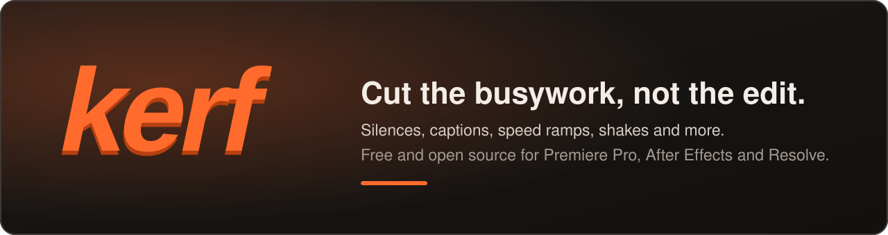
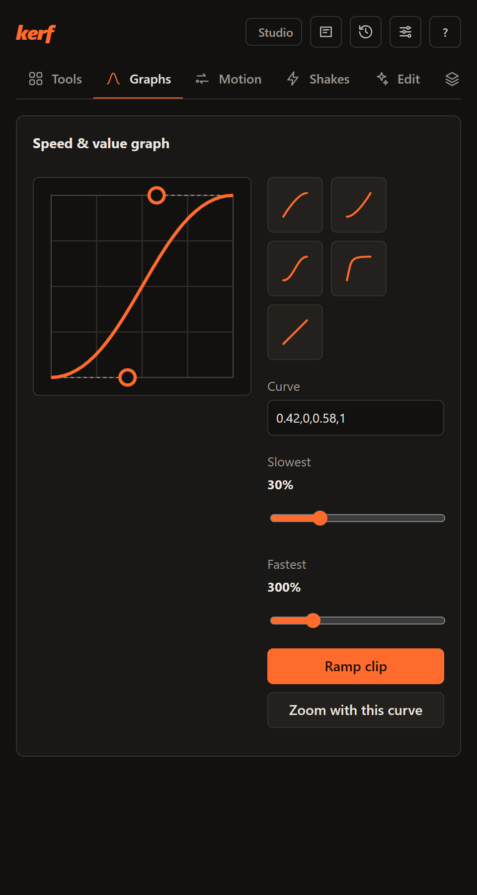
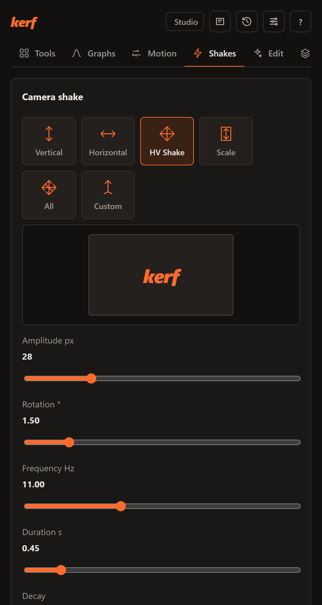
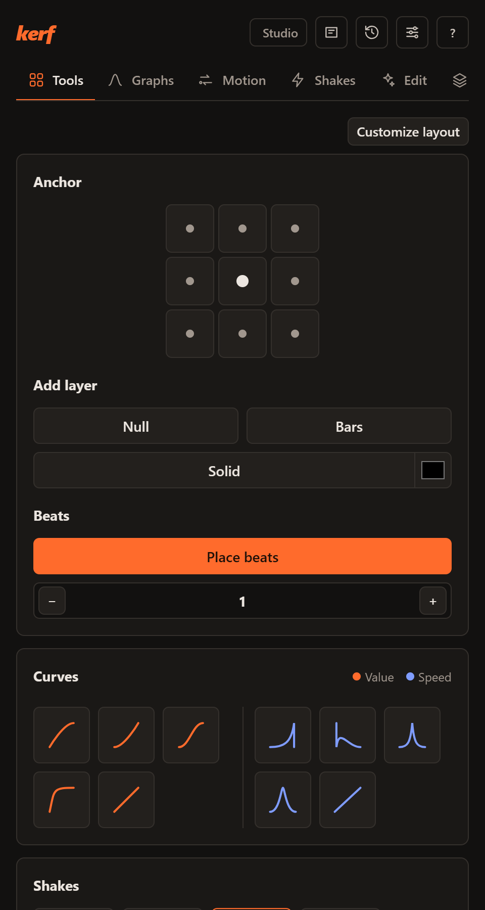
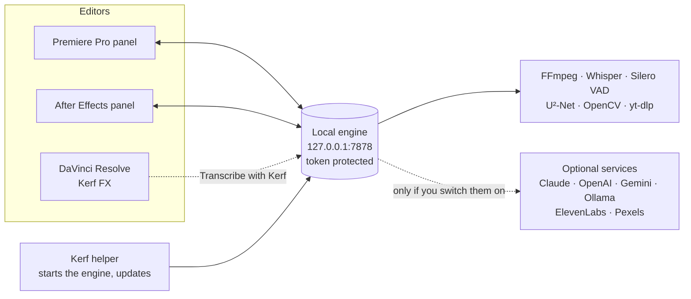

<div align="center">



<br>

[](https://github.com/kamalivaturi/kerf/releases/latest)
[](LICENSE)
[](#-install)
[](#-privacy)

**[Download](https://github.com/kamalivaturi/kerf/releases/latest)** &nbsp;·&nbsp;
**[Website](https://kamalivaturi.github.io/kerf/)** &nbsp;·&nbsp;
**[Install](#-install)** &nbsp;·&nbsp;
**[Use it](#-use-it)** &nbsp;·&nbsp;
**[Features](#-features)** &nbsp;·&nbsp;
**[Privacy](#-privacy)** &nbsp;·&nbsp;
**[Changelog](CHANGELOG.md)**

<br>

&nbsp;&nbsp;
&nbsp;&nbsp;


</div>

<br>

## ✨ What Kerf is

Kerf is a **free, open-source editing toolkit**. It adds a panel to **Premiere Pro** and **After Effects**, and an
effect called **Kerf FX** to **DaVinci Resolve**. It reads your open timeline, does the repetitive work, and hands back
a **new** sequence, clips or markers. Your original edit and media files are not altered.

| | |
|---|---|
| ✂️ **Cut faster** | Remove silences, bad takes and filler words, review the cuts first, then apply. |
| 💬 **Caption anything** | Word-timed animated captions in 21 mixed-language profiles, plus 194 editable MOGRT templates. |
| 🎬 **Add motion in one click** | Speed ramps, camera shakes, zooms, stabilizer, anchor and layer tools. |
| 🔒 **Stays on your computer** | No account, no tracking, no Kerf server. Online services run only if you switch them on. |

> Kerf is an independent project. It is not affiliated with Adobe or Blackmagic Design.

<br>

## 🧰 Features

<details open>
<summary><b>Kerf FX for DaVinci Resolve</b>: one effect, eight modes</summary>

<br>

In Resolve, Kerf is a single OpenFX effect, **Effects › OpenFX › Kerf › Kerf FX**, with a **Mode** menu. Only the
chosen mode's controls show, and Resolve's own keyframes and live preview work.

| Mode | What it does |
|---|---|
| **Shake** | Camera shake that moves, tilts and hides its own edges: amplitude, frequency, rotation, axis. |
| **Zoom** | Eased zoom in or out at the start or end of a clip, around any point. |
| **RGB split** | Chromatic colour separation. |
| **Vignette** | Darkened edges. |
| **Letterbox** | Any aspect: 2.39, 1.85, 4:3 pillars. |
| **Speed ramp** | Ten one-click ramps inside the clip without changing its length, with strength, play-backwards, smooth frames and motion blur. |
| **Motion blur** | Automatic blur measured from the shot's own pans and tilts, or a directional blur you aim. |
| **Captions** | Word-timed captions in 15 templates (Apple-style fade up and blur in, subtle, karaoke, highlight, box, pop, one word, subtitles). Load an SRT, or point at the clip's media and press **Transcribe with Kerf**. Hindi, Marathi, Bengali, Tamil, Telugu, Kannada, Malayalam, Gujarati, Punjabi and Odia letters join correctly. |

Pixel settings are "at 1080p" and scale with the timeline, so the look matches in 4K, 720p or 9:16.
Timeline features such as silences and AI edits live in the Premiere Pro and After Effects panels.

</details>

<details open>
<summary><b>Toolkit</b>: one-click tools in the Premiere Pro and After Effects panel</summary>

<br>

| Tool | Premiere Pro | After Effects |
|---|---|---|
| **Anchor** (9 positions) | Moves the anchor of selected clips; the picture stays put | Same, multi-layer |
| **Add layer** | Null, Adjustment (reuses yours), Solid, cinematic bars, vignette, thirds guides | Null, Null + Parent, Adjustment, Solid |
| **Beat markers** | Detect tempo, sequence markers every N beats, clear | Comp markers |
| **Curves** (value + speed graph) | Ease selected keyframes; speed ramps (ease in/out, speedramp, custom bezier editor) | Keyframe ease; time-remap ramps |
| **Camera shake** | Vertical, horizontal, HV, scale, all, custom. On the playhead, cuts, beats or whole clip. Editable keyframes or rendered with flash and RGB split. Live preview. | Expression + sliders (stays editable), flash |
| **Stabilizer** | One click (FFmpeg vidstab), smoothness % | Pre-comp + Warp Stabilizer |
| **Zoom in / out** | Eased scale moves (in, out, in-out, your curve) | Eased scale keys |
| **Align & distribute** | 4 edges, distribute H/V, grid, picture-in-picture | Align to comp, distribute |
| **Quick mask** | AI cutout (U²-Net, ONNX) of a region you draw, as an alpha clip above | Draw a mask, get a cutout layer |
| **Project sorter** | Bins: Video, Audio, Images, Graphics, Captions, Sequences, Other | Folders |
| **Frame export** | Playhead frame to Desktop | Comp frame to Desktop |
| **FX presets** | Copy a clip's effect stack (values + keyframes) and apply it to other clips | Effect stacks, expressions included |
| **Custom layout** | Hide and reorder tool cards, saved per project | |

</details>

<details open>
<summary><b>Edit</b>: AI and automation features</summary>

<br>

| Group | Feature | What it does |
|---|---|---|
| 🤖 **AI** | **Prompt Edit** | Type what you want. Claude, OpenAI, Gemini or a local model plans a chain of Kerf features and runs it. |
| | **Pipeline / recipes** | Multi-step macros: TikTok talking head, YouTube vlog, podcast, tutorial, Instagram reel, music video. |
| ✂️ **Cut** | **Silences** | Loudness, Silero speech model, or hybrid (both agree). Presets Calm, Measured, Paced, Energetic, Jumpy. J and L cuts. Review before cutting. |
| | **Transcript & language** | Whisper (large-v3-turbo on an NVIDIA GPU, a smaller model otherwise), auto language detection, 21 mixed-language profiles (Hinglish, Tanglish, Spanglish…), an editable transcript, and a vocabulary that learns from your fixes. |
| | **Repeat · Profanity** | Keep the last take and cut filler words. Beep, mute or cut swearing. |
| 🎨 **Style** | **Captions** | 8 styles, nine animations, live preview with platform safe zones (9:16, 1:1, 16:9), MOGRT or SRT output, translation. |
| | **AutoZoom · B-roll** | Punch-ins on cuts, speech and emphasis. Stock footage (Pexels) or your own folder, picked from the transcript. |
| 🧩 **Graphics** | **MOGRT library + Studio** | 194 templates (captions, titles, lower thirds; 14 animations × 5 looks) built in After Effects, every control editable in Essential Graphics. Live animated previews. Studio: animation, speed, font, size, colours, spacing, kerning, alignment, box, shadow, glow, saved as your own MOGRT. Import any `.mogrt`. |
| 🔊 **Audio** | **Enhance · Music · SFX** | Local or ElevenLabs voice cleanup. Music that ducks under speech. Sound-effects pack on cuts. |
| | **Voiceover** | Type a script and 54 natural voices in nine languages speak it on a new audio track (Kokoro, runs locally; the 132 MB voice model downloads once). Or use a speech server. |
| | **Translate & dub** | Dub speech into another language with ElevenLabs (your key). |
| 🎙️ **Multicam** | **Podcast · Angles** | Speaker detection with hysteresis. Switch angles on cuts, pauses or energy. |
| ♻️ **Repurpose** | **Viral · Resize · Chapters · Beat edit** | 0 to 100 scored shorts, face-tracked 9:16 reframing, YouTube chapters, music-video cuts on the beat. |
| 📥 **Import / export** | **Download · Render** | yt-dlp downloader with its options. MP4 up to 4K60 (NVENC, QuickSync, AMF, VideoToolbox) or ProRes 4444 with alpha. Batch folders. |

</details>

<details>
<summary><b>The panel is yours to shape</b></summary>

<br>

Dark "ember" or light theme, accent colour, density and text size. Ten languages (English, Español, Français,
Deutsch, Português, Italiano, Türkçe, Polski, हिन्दी and العربية, with right-to-left layout), or follow your system.
Favourites, search, history, presets you can share, What's new, and F1 help.

</details>

<br>

## 📥 Install

**One installer adds Kerf to every supported editor on your computer.** There is no separate app to open: Kerf runs
in the background while an editor is open and stops about a minute after the last one closes.

| Your computer | Download | Then |
|---|---|---|
| 🪟 **Windows 10 / 11, 64-bit** | `Kerf-…-windows-x64-setup.exe` (or `.msi` for IT deployment) | Run it. It installs the panels and Kerf FX. Allow the one administrator prompt for Kerf FX. |
| 🍎 **macOS 11+**, Apple silicon or Intel | `Kerf-…-macos-arm64.dmg` or `…-macos-x64.dmg` | Drag Kerf to Applications and open it once (right-click, then Open, the first time). |
| 🐧 **Linux (x64)** | `.AppImage`, `.deb` or `.rpm` | For DaVinci Resolve: it installs Kerf FX. |

Find them on the **[latest release page](https://github.com/kamalivaturi/kerf/releases/latest)**. Each release has a
`SHA256SUMS.txt` file to verify your download.

**Where to find Kerf in your editor**

| Editor | Version | Open |
|---|---|---|
| Premiere Pro | 25.6 or newer (Windows, macOS) | **Window › UXP Plugins › Kerf** |
| After Effects | 2022 or newer (Windows, macOS) | **Window › Extensions › Kerf** |
| DaVinci Resolve | 18.6 or newer (Windows, macOS, Linux) | **Effects › OpenFX › Kerf › Kerf FX**. Restart Resolve after installing. |

> **First launch warning.** The builds are not code-signed yet, so Windows SmartScreen or macOS Gatekeeper asks once.
> Windows: **More info › Run anyway**. macOS: right-click the app and choose **Open**, or use System Settings ›
> Privacy & Security › **Open Anyway**. If macOS says the app is damaged, run
> `xattr -dr com.apple.quarantine /Applications/Kerf.app` in Terminal.

<details>
<summary><b>Other ways to install</b></summary>

<br>

| Method | How |
|---|---|
| **Portable, no installer** | Download `kerf-portable-…` (zip or tar.gz), unpack, run `kerf-engine/kerf-engine serve`, and install the Premiere panel from `kerf-premiere-….ccx`. |
| **Python** | `pip install kerf-…whl` (or `pip install -e ".[ai]"` from a clone), then `kerf serve`. Needs FFmpeg on your PATH. |
| **Panels by hand** | The release also lists the Premiere Pro `.ccx` and the After Effects panel zip. |

</details>

**Update and uninstall**

- Kerf checks for new versions while an editor is open, downloads them in the background and installs them after you
  close your editors. Turn this off in **Settings › Automatic updates**.
- Uninstall from your system's app list (Windows: Settings › Apps). Your data lives in the `.kerf` folder in your user
  folder; delete it to remove settings, downloaded models and caches.
- Upgrading from Kerf Studio 0.2.x removes the old app automatically.

<br>

## ⚙️ Set up

Open **⚙ Settings** in the Kerf panel. Everything is optional: Kerf works without any account or key.

| Setting | What it is for |
|---|---|
| **AI provider and key** | Prompt Edit, chapter titles, viral ranking, translation and B-roll search terms. Choose Claude, OpenAI, Gemini, or a local model (Ollama, LM Studio, any OpenAI-compatible server). |
| **ElevenLabs key** | Studio voice cleanup and Translate & dub. |
| **Pexels key** | Stock-footage B-roll. |
| **Speech server** | Voiceover through VoiceStudio on your computer (default `http://localhost:3900/v1`) or any OpenAI-compatible speech API. |
| **Whisper model and device** | `auto` uses large-v3-turbo on an NVIDIA GPU and a fast model on the CPU. A GPU is not required. |
| **Automatic updates** | On by default. |
| **Run only while an editor is open** | Kerf stops about a minute after your editors close. |

Keys are stored on your computer in `.kerf/settings.json` as plain text, shown masked in the panel, and sent only to
the provider they belong to. Protect your user account accordingly.

| AI provider | Default model | Used for |
|---|---|---|
| Claude (Anthropic) | `claude-opus-5-5` | Prompt Edit, chapter titles, viral rerank, translation, B-roll queries |
| OpenAI | any model id | same |
| Google Gemini | any model id | same |
| Local (Ollama, LM Studio…) | any model id | same, and nothing leaves your computer |

<br>

## 🚀 Use it

<details open>
<summary><b>Premiere Pro and After Effects</b></summary>

<br>

1. Open a project and a sequence (or composition).
2. Open **Kerf** from the Window menu (see the table above). The panel shows your project and playhead live.
3. **Tools, Graphs, Motion and Shakes** tabs hold one-click tools: pick clips or layers, press a button.
4. **Edit** tab: pick a feature, such as **Silences**. Choose a preset, press **Preview** to review the cuts, then **Run**.
5. Kerf builds a **new sequence** (or adds clips and markers you can undo). Your original edit stays as it was.
6. For captions, choose a style, check the safe-zone preview, pick the output (overlay, MOGRT or SRT), then run.

Press **F1** for help inside the panel.

</details>

<details open>
<summary><b>DaVinci Resolve (Kerf FX)</b></summary>

<br>

1. Restart Resolve once after installing.
2. In the Edit, Color or Fusion page, drag **Effects › OpenFX › Kerf › Kerf FX** onto a clip.
3. In the Inspector, pick a **Mode** (Shake, Zoom, Speed ramp, Captions…). Keyframe any control with Resolve's own keyframes.
4. **Captions mode:** choose a template, then load an SRT, or select the clip's media file and press **Transcribe with Kerf**.
   - On a clip whose start you trimmed, captions can run late. Set **Sync** to minus the trimmed seconds (trimmed 2 s: −2).

</details>

<details>
<summary><b>Command line</b></summary>

<br>

```bash
kerf run silences --media talk.mp4 --preset Paced
```

```bash
kerf batch captions D:\Shorts --preset "Bold Yellow" --render
```

```bash
kerf run camera_shake --media clip.mp4 --set on=whole --set axis=hv --set output=render
```

`kerf features` lists every feature and its settings.

</details>

<details>
<summary><b>Troubleshooting</b></summary>

<br>

| Problem | Try |
|---|---|
| The panel says Kerf is offline | Reopen the panel. The helper starts the engine when an editor opens. If it persists, restart the editor, then use **Settings › Report a bug**. |
| Kerf FX is not in Resolve's Effects list | Restart Resolve. Kerf FX installs to the standard OpenFX folder with one administrator prompt per new version. |
| Windows or macOS warns on first launch | Expected for unsigned builds. See the First launch warning above. |
| Something failed | Errors are kept locally in `.kerf/logs/errors.jsonl`. **Report a bug** pre-fills a GitHub issue; nothing is sent until you submit it. |

</details>

<br>

## 🔒 Privacy

**Kerf runs on your computer. It has no account, no analytics and no server of its own.**

- **The website** sets no cookies and uses no analytics. GitHub hosts it and logs visitor IP addresses. One browser
  setting, your light or dark theme, stays on your device.
- **The software** keeps its files in a `.kerf` folder on your computer. The local engine listens only on
  `127.0.0.1`, and every request needs a token.
- **Only when you use a feature** does anything leave your computer:

| Feature | Goes to | What is sent |
|---|---|---|
| Updates, model downloads | GitHub, Hugging Face | An ordinary web request |
| AI features | The provider you set up | Your prompt, a timeline summary and sometimes transcript text. Not your video or audio |
| Stock footage | Pexels | Search words |
| Voice cleanup, dubbing | ElevenLabs | Audio from the tracks you choose |
| Downloader | The site you paste | What a browser sends |

Read more: **[PRIVACY.md](PRIVACY.md)** (what Kerf keeps and sends) ·
**[Privacy policy](https://kamalivaturi.github.io/kerf/privacy.html)** ·
**[Cookies](https://kamalivaturi.github.io/kerf/cookies.html)** ·
**[Terms](https://kamalivaturi.github.io/kerf/terms.html)** ·
**[Refunds](https://kamalivaturi.github.io/kerf/refund.html)**

<br>

## 🏗️ How it works



The panel reads the timeline, the engine builds the new edit, and the editor applies it (FCP7 XML, clips or markers).

```
kerf/          engine (Python): timeline model, one module per feature, local server, CLI, licensing
ui/            React + TypeScript + SCSS (Vite) -> dist-uxp/ (Premiere) and dist/ (After Effects panel)
aftereffects/  After Effects panel (ExtendScript)
ofx/           Kerf FX, the OpenFX effect for DaVinci Resolve (C++)
desktop/       installer and background helper (Tauri 2, Rust) -> .exe .msi .dmg .AppImage .deb .rpm
mogrt/         After Effects MOGRT builder
scripts/       engine freezer and release builder
```

<br>

## 🧪 Develop

```bash
python tests/test_core.py
```

```bash
cd ui && npm install && npm run build
```

```bash
python scripts/build_engine.py && cd desktop && npm install && npx tauri build
```

CI tests the engine on Windows, macOS and Linux, and every `v*` tag builds all installers. Drop a Python file in
`.kerf/plugins/` and its feature appears in every panel. Design notes: [dev-docs/DESIGN.md](dev-docs/DESIGN.md).
Ideas for a future paid plan, none of them on sale: [dev-docs/MONETIZATION.md](dev-docs/MONETIZATION.md).

<br>

## ⚠️ Known limits

- macOS and Windows builds are not code-signed yet, so the system asks once on first launch.
- Premiere's scripting has no "create adjustment layer" call: make one once and Kerf reuses it.
- Some third-party After Effects scripts open as floating windows when run from the Kerf Scripts hub (that is how
  After Effects runs ScriptUI panels from a script).
- Kerf FX captions run late on a clip whose start you trimmed: set Sync to minus the trimmed seconds.

<br>

## 📄 Licence and notices

Kerf is released under the **[MIT licence](LICENSE)**. It bundles FFmpeg (GPL-3.0-or-later) and other open-source
work; see **[NOTICES.md](NOTICES.md)** for every component and its licence. Adobe, Premiere Pro and After Effects are
trademarks of Adobe Inc., and DaVinci Resolve is a trademark of Blackmagic Design Pty Ltd. Kerf is an independent
project and is not affiliated with either company.

<br>

<div align="center">

## ☕ Support Kerf

Kerf is free and stays free. If it saves you editing time, a coffee keeps new tools coming.
Tips are optional and unlock nothing.

<a href="https://buymeacoffee.com/kamalivaturi"></a>

</div>
